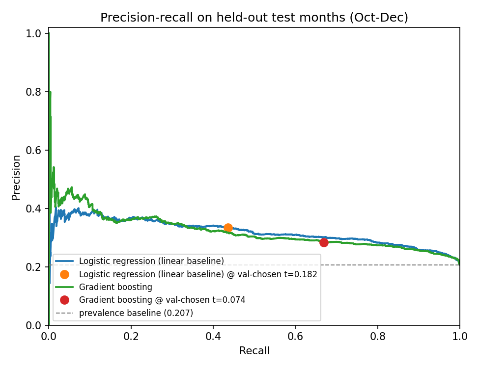
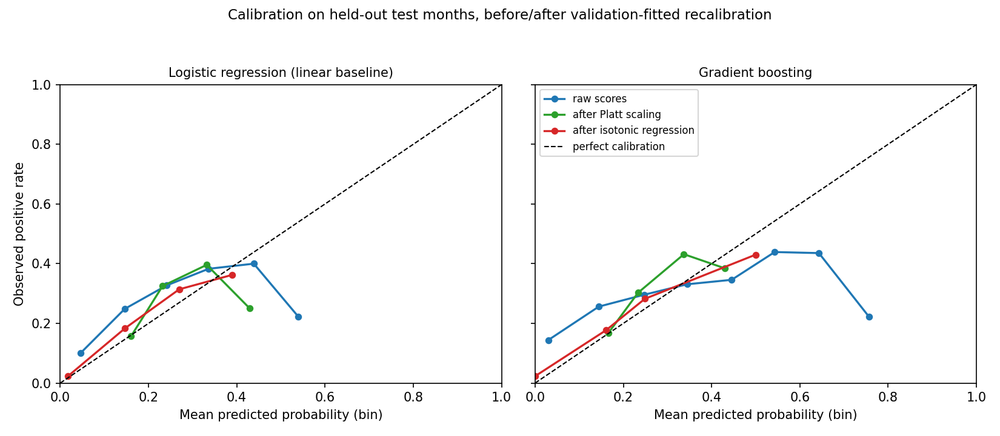

# Purchase Intent Calibration

How well can session-level browsing features distinguish purchases from
non-purchases? And how reliable are the resulting model probabilities?
This is an offline evaluation of completed-session aggregates, not a
demonstration of prediction during an ongoing session.

This project trains two models on the public
[Online Shoppers Purchasing Intention dataset](https://archive.ics.uci.edu/dataset/468/online+shoppers+purchasing+intention+dataset)
(UCI ML Repository, ID 468): a **logistic regression baseline** and a
**gradient boosting** ensemble, then compares them on ranking quality
(PR-AUC), probability quality (Brier score, calibration error) and decision
quality (precision/recall at a validation-chosen threshold).

**Headline finding (measured, not aspirational):** without `PageValues`, the
remaining session-level features are only weakly predictive (test PR-AUC ~0.32 vs a
0.207 prevalence baseline). With `PageValues`, test PR-AUC jumps to 0.60-0.66.
The availability of `PageValues` at a live decision point is not established
by this static dataset, so it is **excluded by default** as a conservative
choice. Removing it does not make the other full-session features available
early. See [Results](#results) and [Limitations](#limitations).

## Dataset

- **Source:** UCI Machine Learning Repository, dataset 468,
  [dataset page](https://archive.ics.uci.edu/dataset/468/online+shoppers+purchasing+intention+dataset)
  (license and citation below verified on that page on 2026-11-24).
- **Size:** 12,330 sessions, 17 features + `Revenue` label (15.47% positive),
  one year of traffic on one site, one session per user.
- **License:** Creative Commons Attribution 4.0 International (CC BY 4.0).
- **Citation (dataset):**
  Sakar, C. & Kastro, Y. (2018). Online Shoppers Purchasing Intention Dataset
  [Dataset]. UCI Machine Learning Repository. https://doi.org/10.24432/C5F88Q
- **Introductory paper:**
  C. O. Sakar, S. Polat, M. Katircioglu, Y. Kastro (2019). Real-time
  prediction of online shoppers' purchasing intention using multilayer
  perceptron and LSTM recurrent neural networks. *Neural Computing and
  Applications*.

The CSV used here has SHA-256
`b3055ee355f59134d851d32641183cb4a8b45def7124d2f50442a042f358e0d9`
(pinned and checked in `tests/test_data.py`).

## Quickstart

```bash
pip install -r requirements.txt   # pinned versions
make train && make eval           # downloads data, trains, evaluates, plots
make test                         # 52 tests
make lint                         # ruff
```

`make train` runs both configurations (without and with `PageValues`) and
writes `results/metrics.json` and `results/metrics_pagevalues.json`.
`make eval` regenerates every figure from a fresh experiment run. Every number
in this README is copied from those committed output files; nothing is typed
from memory. CI (`.github/workflows/ci.yml`) runs lint, the full test suite
including dataset validation, and a smoke train on a subsample.

## How it works (the 60-second version)

1. **Split by time, not by lottery.** Sessions are ordered by `Month`:
   train on Feb-Jul (6,175 sessions, 10.6% positive), tune on Aug-Sep
   (881, 18.4%), and test exactly once on Oct-Dec (5,274, 20.7%). A random
   split would leak seasonal patterns (November holiday shopping behaves
   nothing like March) into training and inflate every metric.
2. **Encode features.** Numeric behaviour counts/durations are standardised;
   the integer-coded IDs (browser, OS, region, traffic type) are treated as
   categories and one-hot encoded, not as magnitudes. `PageValues` is dropped
   by default (see the leakage discussion below).
3. **Train two models from scratch.** Logistic regression (the linear
   baseline) and histogram gradient boosting (sklearn's LightGBM-style tree
   ensemble). No pretrained weights or embeddings anywhere.
4. **Choose the decision threshold on validation only.** The F1-maximising
   threshold is picked on Aug-Sep scores, frozen, and only then applied to
   Oct-Dec. Test metrics at fixed thresholds 0.3 and 0.5 are also reported
   for the cost framing below.
5. **Measure probability quality, not just ranking.** PR-AUC and ROC-AUC
   measure ranking; Brier score and expected calibration error (ECE) measure
   whether "30% likely" actually means 30%. Platt scaling and isotonic
   regression are fitted on validation scores and evaluated on test, so the
   calibration improvement is a held-out estimate.

## Results

All numbers are on the held-out test months (Oct-Dec) unless marked
"validation". Reproduce with `make train` - outputs land in
`results/metrics*.json`.

### Default configuration (PageValues excluded, session-level features)

| Model | Split | PR-AUC | ROC-AUC | Brier | ECE |
|---|---|---|---|---|---|
| Logistic regression | validation | 0.2786 | 0.6564 | 0.1465 | 0.0546 |
| Logistic regression | **test** | **0.3202** | **0.6843** | **0.1599** | **0.0773** |
| Gradient boosting | validation | 0.2559 | 0.6039 | 0.1575 | 0.0973 |
| Gradient boosting | **test** | **0.3213** | **0.6706** | **0.1671** | **0.1023** |

Test prevalence baseline for PR-AUC: 0.207. Both models beat it, but the
honest reading is that the remaining session-level features are only weakly informative:
a PR-AUC of 0.32 is a signal, not a product.

**Decision thresholds.** The F1-optimal threshold chosen on validation and
frozen, then applied to test:

| Model | Val-chosen threshold | Test precision | Test recall | Test F1 |
|---|---|---|---|---|
| Logistic regression | 0.182 | 0.334 | 0.435 | 0.378 |
| Gradient boosting | 0.074 | 0.284 | 0.669 | 0.399 |

**Cost framing (0.3 vs 0.5).** If a false alarm (showing an offer to someone
who would not buy) costs about half as much as a missed purchaser, a lower
threshold than the 0.5 default is appropriate. On test:

| Model | Threshold | Precision | Recall | F1 |
|---|---|---|---|---|
| Logistic regression | 0.3 | 0.378 | 0.096 | 0.153 |
| Logistic regression | 0.5 | 0.182 | 0.002 | 0.004 |
| Gradient boosting | 0.3 | 0.362 | 0.200 | 0.257 |
| Gradient boosting | 0.5 | 0.433 | 0.062 | 0.109 |

Both models' raw scores sit almost entirely below 0.5 in this configuration,
so the textbook 0.5 default is nearly useless here (recall of 0.2-6%) - a
concrete demonstration that the threshold is a business decision, not a
constant, and that it must be chosen on held-out data.

**Calibration, before and after validation-fitted recalibration (test):**

| Model | Raw ECE / Brier | Platt ECE / Brier | Isotonic ECE / Brier |
|---|---|---|---|
| Logistic regression | 0.0773 / 0.1599 | 0.0291 / 0.1581 | 0.0336 / 0.1558 |
| Gradient boosting | 0.1023 / 0.1671 | 0.0198 / 0.1590 | 0.0251 / 0.1562 |

Boosting is the more over-confident model raw (ECE 0.102) and benefits most
from recalibration. See `results/reliability.png` for the reliability
diagrams.

### Comparison configuration (PageValues included)

| Model | Split | PR-AUC | ROC-AUC | Brier | ECE |
|---|---|---|---|---|---|
| Logistic regression | **test** | **0.6053** | **0.8175** | **0.1275** | **0.0853** |
| Gradient boosting | **test** | **0.6615** | **0.8360** | **0.1238** | **0.1017** |

With PageValues included, gradient boosting clearly wins on ranking
(0.66 vs 0.61 PR-AUC) and reaches 0.723 precision at its validation-chosen
threshold (0.417) on test. Calibration after Platt/isotonic: logistic ECE
0.0368/0.0300, boosting ECE 0.0421/0.0528 (Brier 0.1180-0.1251).

**Why PageValues is excluded by default.** The dataset describes an average
page-value feature related to pages visited before a transaction. That
description alone does not establish exactly how it was computed for each
row or when it would be available in a live system. Its strong association
with the target warrants checking feature provenance and decision-time
availability before deployment, rather than treating the higher scores as
proof of real-time usefulness. Both configurations use published
session-level aggregates. Neither establishes performance on partial
sessions. The with/without comparison is reported rather than hidden.




## Limitations

The isotonic calibrator is fitted on only 881 validation rows (approximately 162 positives), so its stepwise probabilities may be unstable and need more calibration data before practical use.

- **Session-level evaluation, not a proven real-time decision system.**
  Features are the full-session aggregates from the published file. A
  deployment would need to re-derive them from partial sessions, and performance
  would need to be measured again. Nothing here demonstrates live performance.
- **One temporal split.** A single train/val/test cut is reported; there are
  no confidence intervals across multiple time folds. The strong label drift
  (10.6% positives in train vs 20.7% in test, driven by November holiday
  traffic) means absolute numbers would move under different cuts.
- **Default hyperparameters.** No tuning was done beyond sklearn defaults,
  so both models are lower bounds; the comparison protocol (not the absolute
  numbers) is the contribution.
- **Duplicate rows.** The published CSV contains 125 fully duplicated rows
  (76 groups). They never disagree on the label (verified in
  `tests/test_data.py`) and are kept as published.
- **One site, one year (2018-era data).** No claim of generalisation to
  other shops, other years, or mobile traffic mixes.

## Development notes

- Developed with AI assistance (code generation and review); all design
  decisions and every reported number were produced by running the committed
  code locally.
- Both models are trained from scratch on this dataset. No pretrained
  weights, frozen feature extractors or fine-tuning are involved.
- No paid APIs, no external services beyond the public dataset download.

## Repository layout

```
data/                 downloaded CSV (gitignored; make data fetches it)
results/              committed metrics.json outputs and figures
scripts/              download_data.py, run_experiment.py, make_plots.py
src/purchase_intent/  data, features, metrics, calibration, training, plots
tests/                52 tests: data validation, metric unit tests with
                      hand-computed values, feature policy, calibration
                      behaviour, end-to-end smoke train on a subsample
Makefile              one-command reproduction: make train && make eval
.github/workflows/    CI: lint + tests + smoke train
```

## Licenses

- **Code:** MIT, see `LICENSE`.
- **Dataset:** CC BY 4.0, (c) Sakar & Kastro, citation above. The dataset is
  not redistributed in this repository; `make data` downloads it from UCI.
- **Libraries:** scikit-learn (BSD 3-Clause), pandas (BSD 3-Clause),
  NumPy (BSD), SciPy (BSD), Matplotlib (PSF-based).
